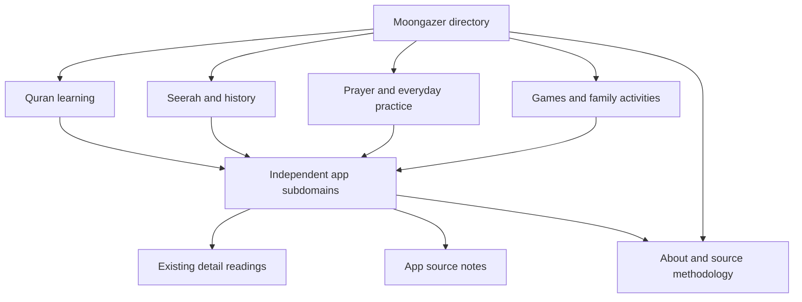

# Moongazer search content improvements

Scope agreed through the user's request on 30 October 2026 Asia/Dhaka. Use the newly installed SEO audit, AI SEO, site architecture and schema guidance. The programmatic SEO guidance informs the quality limit: add four useful subject guides, rather than many near-identical keyword pages.

## Observed baseline

- The published collection already has custom-host canonicals, page-specific metadata, local social previews, structured data, 21 per-host sitemaps, crawlable app links and source/privacy controls. The previous release passed 327-page static validation.
- The live homepage has a poetic H1 and no subject-guide URLs. Its category filters change the same page in JavaScript. An app directory is present in static HTML.
- App homepages mostly use poetic headings. Existing activities and source notes are useful, but there is no consistent concise product explanation, app-specific question section or contextual route into another relevant app.
- Search Console Performance and Page indexing both still say "Processing data, please check again in a day or so." No query, position, click or indexed-page baseline is available. Do not call a missing metric zero or claim a ranking increase.
- The user supplied nrshafi1@gmail.com as the public source-correction contact. Do not infer a public personal name or scholarly credentials from the signed-in Google account.

## Implementation

1. Align the directory and twenty app H1s with their actual subject and utility. Keep the independent full-name app subdomains and existing detail routes.
2. Publish four authored subject pages at /quran-learning/, /seerah-history/, /prayer-everyday-practice/ and /islamic-games/. Each guide explains how to choose among the existing tools and links directly to them. The collection data owns its title, description, audience and reading paths.
3. Add /about/ with the actual source methodology, educational limits, privacy/storage explanation and the user-authorized corrections contact. Describe existing app/source behavior; do not add new religious claims or copy third-party course material.
4. Add app-local static learning guidance: a direct product explanation, short use instructions, two specific questions and two relevant app links. The content is visible to people and available without JavaScript. Preserve every canonical quotation, source record and activity engine.
5. Generate an optional llms.txt index from the same public directory and guide content. It is a navigation aid, not a Google ranking requirement. Do not add speculative AI markup, ratings, testimonials, biographies, multilingual variants or paid-platform integrations.
6. Extend the existing SEO validator for the new directory routes, related-link coverage and static guidance. Retain custom-host indexability and Pages-origin noindex rules. Build, check, test, inspect mobile/desktop layouts and verify the published responses.

## Page hierarchy and keyword ownership

| Owning page | Intent | Navigation |
| --- | --- | --- |
| / | Free Islamic learning apps and Quran games | Directory, four subject guides, About |
| /quran-learning/ | Quran learning tools, reading and theme exploration | Eight Quran apps and other subject guides |
| /seerah-history/ | Seerah and Islamic history learning tools | Three history apps and other subject guides |
| /prayer-everyday-practice/ | Salah meanings and everyday Islamic learning activities | Five practice tools and other subject guides |
| /islamic-games/ | Islamic games and family learning activities | Four challenge apps and other subject guides |
| /about/ | Moongazer source methodology and corrections | Directory, guides, app sources, public contact |
| Each app home | Its existing tool's specific task | Own sources, subject guide and two related apps |
| Existing detail routes | The existing reading or exercise | Own app and visible breadcrumb |

Use English as the current complete UI language. Arabic quotations do not create separate locale pages. Preserve the user's chosen subdomain architecture rather than moving existing URLs for a speculative SEO benefit. Topic choices are based on the inspected products and search-result intent, not invented search-volume data.

## Research and limits

Official search guidance checked for this change:

- https://developers.google.com/search/docs/fundamentals/creating-helpful-content
- https://developers.google.com/search/docs/appearance/title-link
- https://developers.google.com/search/docs/appearance/ai-features

Google says its normal search requirements apply to AI features. The installed skills' numerical citation-lift claims and platform forecasts are not treated as a forecast for this site. No ranking, indexing or AI recommendation guarantee is made. No outreach messages, paid links, subscriptions or scheduled monitoring are authorized by this implementation.

After enough Search Console data exists, compare relevant query/page pairs over a stable period. Evaluate impressions, clicks, CTR and position separately from sitemap discovery. Avoid repeatedly rewriting titles before there is data to assess the changes.
