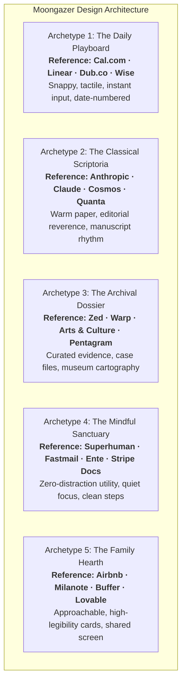

# Moongazer Design System Recommendations

**Source Catalog:** [https://opendesignmd.com/api/designs.json](https://opendesignmd.com/api/designs.json)  
**Established:** 8 November 2026 (Asia/Dhaka)  
**Location:** `plan/DESIGN_RECOMMENDATIONS.md`  
**Target Scope:** Moongazer Directory Hub (`moongazer.tech`) and the 20 Islamic Product Lab apps (`apps/*`)

---

## 1. Executive Summary & Core Challenge

### The Problem: Overcoming "The Sameness Trap"
As documented in `plan/REPORT.md` (Section A2):
> *"Sameness. Every app opens with the same pattern: a dash-and-eyebrow line, a very large Newsreader heading, a paragraph, and the same eight-point star watermark on the right. Accent colour and a 38 px logo are the only differences. Moving between apps feels like reloading one app."*  
> Furthermore, on mobile (375 × 812 px), interactive elements are often pushed below the fold by caveats, disclaimers, and redundant text blocks.

### The Objective
Transform Moongazer's 20 static applications into an interconnected yet visually distinct portfolio. Rather than applying a single generic layout everywhere, we categorize the collection into **5 Design Archetypes**, drawing direct inspiration from curated modern web design systems cataloged at [opendesignmd.com/api/designs.json](https://opendesignmd.com/api/designs.json).

### Non-Negotiable Product Constraints (Islamic Product Lab & Project DNA)
1. **Strict Aniconism:** No images of living beings (people, animals, faces). Visual identity relies on sacred geometry, architectural lines, celestial astronomy (crescent, lunar phases), manuscript borders, and typography.
2. **Strict Sound Policy:** No music, no bells. Sound, if opted-in by the user, consists only of soft, non-musical tactile clicks or authentic Quran recitation audio.
3. **Local Assets & Privacy-First:** 100% locally hosted fonts (`DM Sans`, `Newsreader`, `Amiri`) and SVGs; no third-party CDNs, runtime external APIs, or tracking scripts.
4. **Activity-First Mobile Viewport:** The primary interactive element (board, search input, scenario cards, step 1) must be rendered within 600 px from the top at 375 × 812 px.
5. **Reverence for Canonical Text:** Arabic Quranic text in Amiri at generous line height (1.6–1.8 rem), with proper honorifics (`ﷺ` and `عليه السلام`).

---

## 2. The 5 Moongazer Design Archetypes



### Archetype 1: The Daily Playboard (Tactile Daily Games)
* **Design Philosophy:** Crisp, high-contrast, tactile game mechanics. Instant feedback, numbered daily runs, spoiler-free share grids.
* **Key Inspirations:**
  * **`cal` (Cal.com):** Monochromatic canvas, clean borders, black primary action buttons, tactile pill toggles.
  * **`linear-app` (Linear) & `dub-co` (Dub.co):** Pixel-dense layout, responsive keyboard shortcuts, micro-status badges.
  * **`wise` (Wise):** Energetic high-contrast accents (lime/mint/teal) that bring immediate focus to the action.
* **Layout Rule:** Screen 1 at 375 × 812 px shows the game board or clue deck immediately. Mode switchers (`Daily #N` · `Practice`) stay pinned in the header bar.
* **UI Signature:** Beveled interactive tiles, keyboard controls (`1-4`, `Space`), and a date-stamped completion card.

### Archetype 2: The Classical Scriptoria (Sacred Readers & Contemplation)
* **Design Philosophy:** Calm, unhurried, scholarly, dignified. High editorial elegance reminiscent of fine bookbinding and Islamic manuscript traditions.
* **Key Inspirations:**
  * **`anthropic` (Anthropic) & `claude` (Claude):** Soft warm-paper canvas (`#FBFBF8`), terracotta/warm-amber ink accents (`#CC785C`), generous leading.
  * **`cosmos-so` (Cosmos):** Paper-white canvas (`#F7F4ED`), black typographic spine, loose rounded media cards.
  * **`quantamagazine-org` (Quanta Magazine):** Authoritative serif display typography, clean editorial margins, structured section rules.
* **Layout Rule:** Max-width 680 px centered reading column. Amiri Arabic rendered prominently at 1.75 rem. Caveats tucked into a compact top-right *"Notes & Sources"* drawer.
* **UI Signature:** Archival margin rules, rubrics (colored callout tags), and clean geometric vector motifs (ark, staff, olive branch, lamp).

### Archetype 3: The Archival Dossier (Investigation, History & Atlas)
* **Design Philosophy:** Evidence-based, structured, investigative. Blends museum curation with engineering workbench precision.
* **Key Inspirations:**
  * **`zed-dev` (Zed) & `warp-dev` (Warp):** Warm charcoal and stone surfaces (`#2B2622`, `#F7F5F0`), monospace metadata chips, terminal-clean dossier tabs.
  * **`artsandculture-google` (Google Arts & Culture) & `nga-gov` (National Gallery of Art):** Gallery-grade spatial cards, restrained chrome, photographic and cartographic framing.
  * **`pentagram` (Pentagram):** Radical typographic restraint, stark structural grids, no decorative noise.
* **Layout Rule:** Sticky chronological era ribbons (`Makkah 610–622` · `Madinah 622–632`) or omnibox search hero with instant result highlighting.
* **UI Signature:** Archival index tabs, evidence stamp badges (*"Corroborated"*, *"Reported Occasion"*, *"Location Uncertain"*), and interactive coordinate crosshairs on maps.

### Archetype 4: The Mindful Sanctuary (Worship, Planners & Practical Tools)
* **Design Philosophy:** Zen utility, zero cognitive friction, deep personal focus.
* **Key Inspirations:**
  * **`superhuman` (Superhuman):** Atmospheric night-sky gradients (`#0E0C1F`, `#1B1938`, `#C9B4FA`) paired with an ultra-clean white/warm-grey interior.
  * **`fastmail` (Fastmail) & `ente` (Ente):** Calm, privacy-centric utility, step-by-step progress tracking, distraction-free calculation panels.
  * **`docs-stripe` (Stripe Docs) & `tailscale` (Tailscale):** Clean dual-column input/summary splits and structured progress checklists.
* **Layout Rule:** Guided step wizard (`1. Current Status` → `2. Weekly Pace` → `3. Plan Summary`) with immediate live calculation.
* **UI Signature:** Circular step indicators, soft ambient completion halos, and printable 1-page pocket guides (`Print / PDF`).

### Archetype 5: The Family Hearth (Interactive Scenarios & Group Halaqa)
* **Design Philosophy:** Warm, conversational, accessible, built for shared multi-generational viewing.
* **Key Inspirations:**
  * **`airbnb` (Airbnb) & `milanote` (Milanote):** Generous whitespace, warm friendly card surfaces (`#FAF5E8`, `#F5F5F0`), high legibility from a distance.
  * **`lovable-dev` (Lovable):** Soft stone backgrounds (`#FCFBF8`), rounded corners, warm amber/coral accents.
  * **`kagi` (Kagi):** Trustworthy ground with playful, encouraging interactive steps.
* **Layout Rule:** Large cards formatted for tablet/phone passed around the room or projected onto a TV (`Projector Mode`). Adult answers hidden behind a tap-to-reveal toggle.
* **UI Signature:** Branching decision cards with constructive ethical feedback, and fold-out facilitator prompts.

---

## 3. Master App-by-App Design Assignment Table

| # | App Name & Path | Archetype | Design Reference (`designs.json`) | Palette (Light / Dark) | Typography | Distinctive UI Signature |
| :-: | :--- | :--- | :--- | :--- | :--- | :--- |
| **0** | **Moongazer Directory**<br/>`moongazer.tech` (`homepage/`) | **The Hub** | **`apple`** + **`research-perplexity-ai`** | Background: `#0A0E17` / `#FCFCFC`<br/>Accent: `#D4A017` (Gold), `#64748D` | Newsreader + DM Sans | Celestial orbit paths, "Tonight on Moongazer" daily card tray, 2-min / 10-min duration chips. |
| **1** | **Guess the Surah**<br/>`apps/guess-the-surah` | Playboard | **`cal`** + **`wise`** | Canvas: `#FFFFFF` / `#111111`<br/>Accent: `#087F75` (Teal), `#9FE870` | DM Sans + Amiri | Daily puzzle `#N` badge, 4-tier progressive clue reveals, spoiler-free share grid. |
| **2** | **Ayah Threads**<br/>`apps/quran-connections` | Playboard | **`linear-app`** + **`arc-net`** | Canvas: `#FAFAFA` / `#0D1218`<br/>Accent: `#00A396` (Cyan-Teal) | DM Sans + Amiri | 3 interconnected ayah cards with glowing illuminated thread connectors upon solve. |
| **3** | **Word Groups**<br/>`apps/islamic-concept-connections` | Playboard | **`dub-co`** + **`sentry-io`** | Canvas: `#F5F5F0` / `#150F23`<br/>Accent: 4 category hues (Gold, Sage, Teal, Amber) | DM Sans + Amiri | 4×4 tactile grid, 4-bubble mistake counter, animated row resolution. |
| **4** | **Quran Escape Room**<br/>`apps/islamic-knowledge-escape-room` | Hearth | **`kagi`** + **`ampcode`** | Canvas: `#181824` / `#F5F0E8`<br/>Accent: `#FFB319` (Amber), `#00FF88` | JetBrains Mono + DM Sans | Chamber progression bar, tactile combination lock dials, side-by-side evidence shelf. |
| **5** | **Is It in the Quran?**<br/>`apps/is-this-actually-in-the-quran` | Dossier | **`cloudflare`** + **`tailscale`** | Canvas: `#FFFFFF` / `#161B22`<br/>Accent: `#F6821F` (Orange), `#2DB87D` | DM Sans + DM Mono | Omnibox search hero with instant ayah highlighter & "Common Claims" verdict cards. |
| **6** | **Stories of the Prophets**<br/>`apps/stories-of-the-prophets-explorer` | Scriptoria | **`anthropic`** + **`claude`** | Canvas: `#F7F4ED` / `#141413`<br/>Accent: `#CC785C` (Terracotta), `#5C6F5D` | Copernicus / Newsreader + DM Sans | Symbolic non-figurative line motifs (ark, staff, well), scene navigator, honorifics helper. |
| **7** | **Parables of the Quran**<br/>`apps/quranic-parables-studio` | Scriptoria | **`cosmos-so`** + **`ouraring`** | Canvas: `#FCFBF8` / `#1C1C1C`<br/>Accent: `#D4A017` (Ochre), `#0A2E0E` | Newsreader + DM Sans | Clean stepped vector diagram illustrating the metaphor (spider web, lamp niche, rain cloud). |
| **8** | **Places in the Quran**<br/>`apps/quranic-places-atlas` | Dossier | **`pentagram`** + **`earth-google`** | Canvas: `#F8F8F8` / `#1F1F1F`<br/>Accent: `#155DB6` (Lapis), `#737373` | DM Sans + JetBrains Mono | Interactive SVG regional map with certainty pins (*"Exact site"*, *"Region"*, *"Uncertain"*). |
| **9** | **Why It Was Revealed**<br/>`apps/revelation-context-explorer` | Scriptoria | **`quantamagazine-org`** + **`medium`** | Canvas: `#FDFCFB` / `#172A35`<br/>Accent: `#9D120D` (Rubric), `#1A8917` | Newsreader + DM Sans | Mushaf surah index, two-sided report card (*"What this shows"* vs *"What it doesn't settle"*). |
| **10** | **Seerah Timeline**<br/>`apps/interactive-seerah-timeline` | Dossier | **`artsandculture-google`** + **`asml`** | Canvas: `#FFFFFF` / `#000000`<br/>Accent: `#C9A227` (Ochre), `#1A73E8` | DM Sans + Newsreader | Dual-view toggle: Linear chronological era stream vs "Which came first?" challenge card. |
| **11** | **Seerah Detective**<br/>`apps/the-seerah-detective` | Dossier | **`zed-dev`** + **`warp-dev`** | Canvas: `#F5F0E8` / `#2B2622`<br/>Accent: `#FFB319` (Amber), `#D94E1F` | JetBrains Mono + Newsreader | Pinned report clips, dossier classification stamps, 3-witness evidence comparison. |
| **12** | **Civilization Timeline**<br/>`apps/islamic-civilization-timeline` | Dossier | **`nga-gov`** + **`christies`** | Canvas: `#F7F7F7` / `#1A1A1A`<br/>Accent: `#002855` (Lapis Navy), `#BFA15A` | Newsreader + DM Sans | Architectural & artifact framing (CC0 museum objects), multi-regional era ribbons. |
| **13** | **Understand Your Salah**<br/>`apps/understand-salah-lab` | Sanctuary | **`superhuman`** + **`fastmail`** | Canvas: `#0E0C1F` / `#FFFFFF`<br/>Accent: `#C9B4FA` (Lavender), `#00AACF` | Newsreader + Amiri | Step-by-step prayer posture journey, tap-to-reveal word meanings, phrase audio looper. |
| **14** | **Hifz Planner**<br/>`apps/quran-memorization-workload-calculator` | Sanctuary | **`docs-stripe`** + **`replit`** | Canvas: `#FFFFFF` / `#0D1117`<br/>Accent: `#24B47E` (Emerald), `#0070F3` | DM Sans + JetBrains Mono | 604-page visual mushaf grid, weekly revision checklist, "I missed a day" re-planner. |
| **15** | **Everyday Akhlaq**<br/>`apps/everyday-akhlaq-simulator` | Hearth | **`lovable-dev`** + **`airbnb`** | Canvas: `#FCFBF8` / `#1C1C1C`<br/>Accent: `#E05A47` (Coral), `#5C6F5D` | DM Sans + Newsreader | Branching dilemma cards with constructive ethics feedback, zero finger-pointing. |
| **16** | **Family Halaqa**<br/>`apps/family-islamic-learning-challenges` | Hearth | **`milanote`** + **`buffer`** | Canvas: `#FAF5E8` / `#1E2D2B`<br/>Accent: `#FFD02F` (Warm Sun), `#147653` | DM Sans + Newsreader | Shared tablet view, 10-minute activity steps, fold-out answer reveal for parents. |
| **17** | **Quran Words** *(Planned)*<br/>`apps/quran-words` | Sanctuary | **`cal`** + **`vercel`** | Canvas: `#FFFFFF` / `#111111`<br/>Accent: `#00F0A0` (Mint), `#00482F` | DM Sans + Amiri | Flashcard swipe/reveal, Quranic frequency rank chip, spaced repetition review queue. |
| **18** | **Names of Allah** *(Planned)*<br/>`apps/names-of-allah` | Scriptoria | **`elevenlabs-io`** + **`ouraring`** | Canvas: `#FAF7F2` / `#17171C`<br/>Accent: `#D4A373` (Rose Gold), `#5C6F5D` | Newsreader + Amiri | 99 Names gallery with audio pronunciation, Quranic citation drawer, contemplation cards. |
| **19** | **Zakat Calculator** *(Planned)*<br/>`apps/zakat-calculator` | Sanctuary | **`mercury`** + **`coinbase`** | Canvas: `#FFFFFF` / `#0A0B0D`<br/>Accent: `#0052FF` (Blue), `#D4A017` (Nisab Gold) | DM Sans + Inter | Nisab metal selector (Gold vs Silver threshold basis), live deductions breakdown, print summary. |
| **20** | **Alif Ba** *(Planned)*<br/>`apps/alif-ba` | Sanctuary | **`arc-net`** + **`nothing-tech`** | Canvas: `#FCFCFC` / `#000000`<br/>Accent: `#FFB319` (Amber), `#00E1D9` | Bold Sans + Calligraphic Arabic | Interactive stroke tracing canvas, 4 positional forms slider (Isolated, Initial, Medial, Final). |

---

## 4. Color & Token System by Subject Family

Following `plan/REPORT.md` (Section A4), visual families are coded by subject matter rather than arbitrary assignments:

### Family 1: Quran (Emerald & Mint Teal)
* **Applications:** Guess the Surah, Ayah Threads, Word Groups, Is It in the Quran?, Stories of the Prophets, Parables, Places, Why It Was Revealed, Quran Words, Alif Ba
* **Light Tokens:** `--bg: #f5f8fa; --surface: #ffffff; --ink: #172a35; --muted: #5c707b; --accent: #087f75; --accent-hover: #06665f; --tint: #e5f3ef;`
* **Dark Tokens:** `--bg: #101a24; --surface: #16232e; --ink: #edf4f7; --muted: #a5b7c1; --accent: #78d4c2; --accent-hover: #9ce7d7; --tint: #203d3c;`

### Family 2: Seerah & History (Desert Gold & Warm Walnut)
* **Applications:** Seerah Timeline, Seerah Detective, Civilization Timeline
* **Light Tokens:** `--bg: #faf7f2; --surface: #ffffff; --ink: #2b2622; --muted: #736c64; --accent: #b8860b; --accent-hover: #996f08; --tint: #fef8eb;`
* **Dark Tokens:** `--bg: #181512; --surface: #221e1a; --ink: #f7f4ed; --muted: #a8a096; --accent: #e5b94e; --accent-hover: #f0cc75; --tint: #332b1f;`

### Family 3: Worship & Daily Life (Midnight Indigo & Sapphire)
* **Applications:** Understand Your Salah, Hifz Planner, Everyday Akhlaq, Names of Allah, Zakat Calculator
* **Light Tokens:** `--bg: #f5f7fc; --surface: #ffffff; --ink: #0e1b2e; --muted: #53637a; --accent: #2563eb; --accent-hover: #1d4ed8; --tint: #eff4fe;`
* **Dark Tokens:** `--bg: #0c121e; --surface: #141c2c; --ink: #eef2f9; --muted: #95a3b8; --accent: #60a5fa; --accent-hover: #93c5fd; --tint: #1c283f;`

### Family 4: Family & Group Play (Amethyst & Warm Heather)
* **Applications:** Family Halaqa, Quran Escape Room
* **Light Tokens:** `--bg: #f8f6fb; --surface: #ffffff; --ink: #261938; --muted: #6e5c85; --accent: #7c3aed; --accent-hover: #6d28d9; --tint: #f3effc;`
* **Dark Tokens:** `--bg: #140e1f; --surface: #1e152d; --ink: #f5f2fa; --muted: #b09fc7; --accent: #a78bfa; --accent-hover: #c4b5fd; --tint: #2c1e42;`

---

## 5. Mobile Layout & UX Polish Guidelines

To satisfy Brief 08 (`plan/agents/08-moongazer-shell-and-directory.md`) and the Depth Gate:

1. **Activity-First Viewport:**
   ```
   +---------------------------------------+
   | [Logo] App Short Name        [Theme]  |  <= Header (48px)
   | "One-line plain descriptor"  [Daily#] |  <= Hero (max 80px)
   +---------------------------------------+
   |                                       |
   |      ACTIVE INTERACTIVE ELEMENT       |  <= Screen 1 (under 600px)
   |   (Game Grid / Cards / Search Hero)   |
   |                                       |
   +---------------------------------------+
   | [v How this works & source notes ]    |  <= Collapsible <details>
   +---------------------------------------+
   ```
2. **Replace the Monolithic Watermark:**
   Remove the repetitive 8-point star background graphic from every app. Instead, give each app its own distinct geometric SVG mark derived from its header logo (e.g., astrolabe for Places, scroll seal for Seerah Detective, book threads for Ayah Threads, scales for Zakat).
3. **End-of-Session Habit Loop:**
   Every activity ends with a standardized four-beat pattern:
   `Result Summary` → `What you learned (with Quran/hadith references)` → `Spoiler-free Share (WhatsApp / Copy)` → `Next Recommended App`.

---

## 6. Design File Architecture (`DESIGN.md` for Root and Every App)

**Mandatory Governance Rule:** Both the repository root and every single application built must maintain its own dedicated `DESIGN.md` file.

### Two-Tier Design Specification Hierarchy:

```
I:\Development\moongazer\
├── DESIGN.md                                 <= Root Design Governance
├── homepage/                                 <= Directory Hub (moongazer.tech)
│   └── DESIGN.md                             <= Hub Layout, Orbit Visuals, Daily Strip
└── apps/
    ├── guess-the-surah/DESIGN.md             <= Daily Playboard Archetype, clue card UI
    ├── quran-connections/DESIGN.md           <= Daily Playboard Archetype, connecting threads
    ├── islamic-concept-connections/DESIGN.md <= Daily Playboard Archetype, 4x4 grid UI
    ├── islamic-knowledge-escape-room/DESIGN.md <= Family Hearth Archetype, chamber UI
    ├── is-this-actually-in-the-quran/DESIGN.md <= Archival Dossier Archetype, omnibox search UI
    ├── stories-of-the-prophets-explorer/DESIGN.md <= Classical Scriptoria Archetype, scene reader
    ├── quranic-parables-studio/DESIGN.md     <= Classical Scriptoria Archetype, vector diagram UI
    ├── quranic-places-atlas/DESIGN.md        <= Archival Dossier Archetype, map & certainty pins
    ├── revelation-context-explorer/DESIGN.md <= Classical Scriptoria Archetype, asbab dossier
    ├── interactive-seerah-timeline/DESIGN.md <= Archival Dossier Archetype, era stream
    ├── the-seerah-detective/DESIGN.md        <= Archival Dossier Archetype, case board
    ├── islamic-civilization-timeline/DESIGN.md <= Archival Dossier Archetype, artifact framing
    ├── understand-salah-lab/DESIGN.md        <= Mindful Sanctuary Archetype, prayer step journey
    ├── quran-memorization-workload-calculator/DESIGN.md <= Mindful Sanctuary Archetype, 604-grid
    ├── everyday-akhlaq-simulator/DESIGN.md   <= Family Hearth Archetype, branching dilemma
    ├── family-islamic-learning-challenges/DESIGN.md <= Family Hearth Archetype, shared tablet UI
    ├── quran-words/DESIGN.md                 <= Mindful Sanctuary Archetype, flashcards
    ├── names-of-allah/DESIGN.md              <= Classical Scriptoria Archetype, 99 names cards
    ├── zakat-calculator/DESIGN.md            <= Mindful Sanctuary Archetype, nisab metal UI
    └── alif-ba/DESIGN.md                     <= Mindful Sanctuary Archetype, stroke tracing
```

### Purpose of Root `DESIGN.md`:
* **Portfolio-Wide Design Governance:** Defines the overarching visual language, global token system (Light/Dark CSS variables), typography scale (`DM Sans`, `Newsreader`, `Amiri`), strict Islamic constraints (aniconism, no music/bells), directory hub aesthetics (`moongazer.tech`), and the definitions of the 5 archetypes.

### Purpose of App-Local `DESIGN.md` (`apps/<slug>/DESIGN.md`):
* **Bespoke App Design Specification:** Defines that specific app's assigned archetype from this document, its exact palette overrides, its custom SVG logo/motif (replacing the generic star watermark), its interactive component states (focused, solved, revealed, error), its screen-1 mobile layout wireframe, and its end-of-session sharing card.
* **Agent Requirement:** Any agent performing UI or shell work on an app must read and adhere to that app's `DESIGN.md` and the root `DESIGN.md`.

---

## 7. Reference Links & Attribution

* Primary Design Database: [opendesignmd.com/api/designs.json](https://opendesignmd.com/api/designs.json)
* Growth and Architecture Plan: `plan/REPORT.md`
* Execution Brief: `plan/agents/08-moongazer-shell-and-directory.md`
* Master Agent Starting Instructions: `plan/agents/00-START-HERE.md`
* UI Context Specification: `context/ui-context.md`
