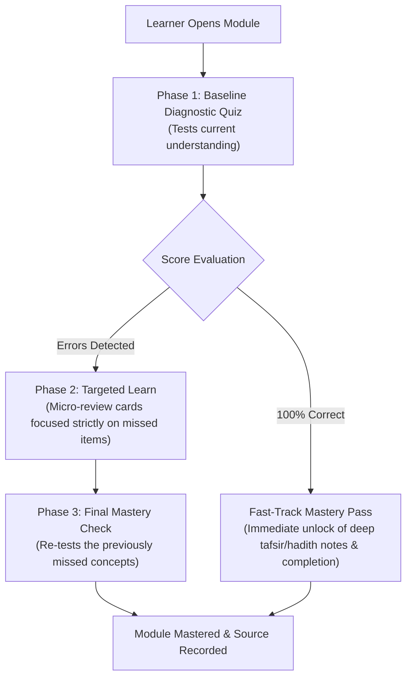

# Moongazer Strategic Decisions & Execution Roadmap

> **Superseded (11 November 2026):** this file is background only. The authoritative execution plan is [`plan/implementation/00-INDEX.md`](implementation/00-INDEX.md). Where they differ, the implementation plan wins.

**Author:** Gemini 3.8 Flash (High Thinking) · Antigravity (Google DeepMind)  
**Date:** 8 November 2026 (Asia/Dhaka)  
**Location:** `plan/MOONGAZER_STRATEGIC_DECISIONS.md`  
**Status:** Settled & Approved by Founder  
**Target Scope:** Moongazer Digital Waqf (`moongazer.tech`) & 20 Islamic Product Lab Applications

---

## 1. Executive Summary & Strategic Foundations

This document records the definitive strategic decisions settled during the founder alignment interview, synthesizing the 20 startup/bootstrapping principles with the non-negotiable core values of the Moongazer digital waqf.

### Core Strategic Principles:
1. **Permanent Waqf Firewalled from Commercial Interests:** Moongazer remains permanently free, ad-free, and tracking-free. It does not monetize, issue fatwas, host social feeds, or run live unverified AI generation.
2. **Discipline Over Motivation (The 13-Week Ramadan Runway):** Ramadan 1448 begins mid-February 2027. All product expansion and major code refactoring are bound by a hard **15 January 2027 Code Freeze**, giving 4 full weeks of production burn-in.
3. **Depth Before Expansion:** Consolidate 20 apps into 16 deeper, source-verified host apps meeting the 4-part Depth Gate before launching any new products.
4. **Trust Precedes Aesthetics:** All 18 trust-damaging defects, broken metadata, and logic giveaways must be 100% remediated and verified in code before visual shell redesigns begin.

---

## 2. Pedagogical Engine: The Diagnostic Mastery Loop

To elevate Moongazer from simple trivia/puzzles into an authentic, habit-forming Islamic learning tool, study and reader applications (*Understand Your Salah*, *Stories of the Prophets*, *Why It Was Revealed*, and *Everyday Akhlaq*) will implement a structured **Diagnostic Mastery Loop**:



### Key Loop Rules:
* **Respect High Knowledge:** Knowledgeable learners who ace the diagnostic quiz are never forced to sit through basic study screens; they receive immediate verification and direct access to advanced classical commentary.
* **Targeted Remediation:** Learners with knowledge gaps are shown micro-learning cards explaining *only* the specific phrases, ayat, or historical facts they missed.
* **Recall Before Reveal:** Canonical Arabic text is presented with tap-to-reveal translation and grammatical notes, enforcing active cognitive recall before passive reading.

---

## 3. Comprehensive Defect Remediation (Brief 06 Scope)

Brief 06 is formally authorized as the immediate next work unit. It encompasses **18 verified trust-damaging defects** divided into two punch-lists:

### Baseline Punch-List (14 Defects from `plan/REPORT.md` Section A0):
1. **Copied Sources Boilerplate:** 10 of 20 apps display copied sources pages describing unrelated applications.
2. **Escape Room Room 1 Spoiler:** Lock 1 is checked against the room’s own title (H1); distractors always draw from the Patience room.
3. **Concept Atlas Answers:** Atlas cards print answers that spoil all 30 puzzles in Quran Connections.
4. **Revelation Context Quiz Giveaway:** Category is printed in the card eyebrow, topic filter, and page heading; 7 of 10 answers are identical.
5. **Halal Business Decisions Logic:** First option is always the "source-aligned" choice in all 12 cases; follow-up is identical regardless of choice.
6. **Misinformation Casebook SEO Leak:** Meta descriptions print answers (`summaryField: "correction"`); titles contain verdicts.
7. **Stories of the Prophets Metadata:** All 25 prophets share identical meta descriptions due to boolean field pointer.
8. **Memorization Calculator Export:** Calendar export references local placeholder UIDs and fixed October 2026 timestamps.
9. **Everyday Akhlaq Scenarios:** The `constructive` flag (121 uses) is never evaluated; second decision is identical regardless of choice.
10. **Shared Shell Inconsistencies:** Hardcoded teal `<meta name="theme-color">` in blue/violet apps; 404 pages copy Places Atlas text; external arrow `↗` used on internal links.
11. **Civilization Timeline Gaps & Notices:** Displays hadith disclaimers on pages with no hadith; map lacks plotted coordinates.
12. **Guess the Surah Clue 1 Duplicates:** 15 surahs share identical first clues ("Alif. Lam. Mim."); hero claims 114 surahs over 51-surah pool.
13. **Understand Salah Meanings:** Translations visible by default; Al-Fatiha audio plays full surah rather than phrase-by-phrase.
14. **Seerah Timeline Missing Links:** Cards promise connected moments but data contains no link fields.

### Newly Approved Punch-List (4 Defects from Alignment Session):
15. **Storage Orphanage on 301 Merges:** When `quran-concept-atlas`, `halal-business-decisions`, `islamic-history-timeline-challenge`, and `islamic-misinformation-casebook` are 301-redirected, client-side localStorage migration must transfer existing saved items to the new host apps without data loss.
16. **Missing BDI Isolation for Bilingual Text:** Inline Arabic phrases embedded within English sentences lack `<bdi>` (Bidirectional Isolation) tags, causing punctuation (brackets, colons, ayah numbers) to invert or corrupt on mobile WebKit and Firefox.
17. **Hardcoded Metadata Years:** Static `2026` strings in JSON-LD schemas, sitemaps, and copyright footers must be updated dynamically to support the 2027 calendar and Ramadan cycle.
18. **Uncaught Offline Audio States:** Audio controls in *Understand Your Salah* must catch network failure and display an inline disabled note (*"Audio unavailable offline"*) rather than hanging in a broken loading state.

---

## 4. First-Party Services Architecture

### A. In-App Feedback & Source Correction Pipeline
* **Hosting & Database:** Hosted on apex domain (`moongazer.tech/api/feedback`) backed by **Cloudflare D1** serverless SQLite.
* **Payload Schema:**
  ```json
  {
    "id": "uuid-v4",
    "timestamp": "ISO-8601",
    "app_slug": "understand-salah-lab",
    "page_url": "/lesson/al-fatiha-1/",
    "category": "source_or_text_correction",
    "message": "Typo in ayah 4 translation...",
    "contact_email": "optional@domain.com",
    "status": "pending"
  }
  ```
* **Bot & Abuse Protection:** Protected by invisible, non-interactive **Cloudflare Turnstile** combined with a hidden honeypot field. Zero invasive CAPTCHAs, zero tracking cookies.
* **Moderation Workflow:** All incoming submissions default to `status: 'pending'`. The maintainer audits submissions locally via CLI (`bun run review-feedback`). Only submissions approved as `status: 'verified'` are rendered on the public `/corrections/` log.

### B. Privacy-Preserving Interaction Telemetry
* **Philosophy:** Measure completion and drop-off objectively without collecting user identity, IP addresses, or cookies.
* **Events Recorded (Only 3):**
  1. `activity_started`
  2. `activity_completed`
  3. `share_clicked`
  *(Page views are strictly excluded; Cloudflare server-side analytics covers DNS/HTTP requests).*
* **Ingestion Mechanism:** Dispatched via browser `navigator.sendBeacon` to Cloudflare Workers Analytics Engine.
* **Fail-Silent Invariant:** If a visitor uses an ad-blocker, operates offline, or disables beaconing, the application continues to run with 100% functionality and zero console errors.

---

## 5. Portfolio Consolidation & The Depth Gate

### 4-App Merge (Brief 10):
| Old App (To be 301-Redirected) | Receiving Host App | New Integrated Feature |
| :--- | :--- | :--- |
| `quran-concept-atlas` | `quran-connections` (Ayah Threads) | Integrated Theme Library unlocked upon solving |
| `islamic-history-timeline-challenge` | `interactive-seerah-timeline` | "Which came first?" daily challenge mode |
| `halal-business-decisions` | `everyday-akhlaq-simulator` | Dedicated Business & Workplace ethical track |
| `islamic-misinformation-casebook` | `is-this-actually-in-the-quran` | "Common Claims" search & verification tab |

### The 4-Part Depth Gate Criteria:
Every single app must satisfy all four gates before Ramadan launch:
1. **Zero Trust Defects:** Passed all Brief 06 punch-list audits.
2. **Activity-First Mobile Viewport:** Primary interactive element rendered within 600 px from the top at 375 × 812 px.
3. **Minimum Content Depth:** At least 30 verified items/puzzles for a full month of daily usage without repeats, or complete canonical coverage (all 114 surahs for Guess the Surah, all 604 pages for Hifz Planner).
4. **Classical Source Transparency:** Every ayah linked to Quran MCP editions; fiqh calculations cite classical schools and standard gold/silver nisab bases without issuing original rulings.

---

## 6. Three-Milestone Execution Roadmap

```
+-----------------------------------------------------------------------------------+
| MILESTONE 1 (Weeks 1–3): Defect Remediation & Core Infrastructure                 |
| - Brief 06: Fix all 18 trust-damaging defects & verify across 325 pages           |
| - Brief 07: Rename apps, clean search headings, standardize honorifics (ﷺ)        |
| - Service Architecture: Cloudflare D1 feedback endpoint + Analytics Engine counter|
+-----------------------------------------------------------------------------------+
                                          |
                                          v
+-----------------------------------------------------------------------------------+
| MILESTONE 2 (Weeks 4–7): Shell Redesign, Daily Puzzles & Portfolio Merges        |
| - Brief 08: Activity-first shells + author root and 20 app DESIGN.md files         |
| - Brief 09: Date-seeded daily puzzle engines (#1, #2...) + WhatsApp share cards   |
| - Brief 10: Execute 4-app 301 redirects, storage migration, and merged features   |
+-----------------------------------------------------------------------------------+
                                          |
                                          v
+-----------------------------------------------------------------------------------+
| MILESTONE 3 (Weeks 8–10): Ramadan Hub, Hifz Upgrade & Depth Gate Audits           |
| - Brief 11: Build Ramadan 1448 Hub + Upgrade Calculator to full Hifz Planner      |
| - Depth Gate Verification: Ensure all 16 apps pass 30+ items & mobile screen 1    |
| - 15 JANUARY 2027: HARD CODE FREEZE                                              |
+-----------------------------------------------------------------------------------+
                                          |
                                          v
+-----------------------------------------------------------------------------------+
| PRODUCTION BURN-IN (15 Jan 2027 – Mid-Feb 2027):                                  |
| - Live testing, feedback moderation, zero breaking code edits                    |
| - Official Launch for Ramadan 1448                                               |
+-----------------------------------------------------------------------------------+
```

---

## 7. Immediate Next Action

Per repository governance rules (`plan/agents/00-START-HERE.md`), **Brief 06 is formally authorized**. 

Execution starts on:
* **Target:** `plan/agents/06-moongazer-fix-defects.md`
* **Scope:** 18 defects across 20 app codebases.
* **Verification:** Run `bun _implementation/verify.ts check`, `test`, `build`, and `python _implementation/verify-static.py`.
